<h1 align="center">
  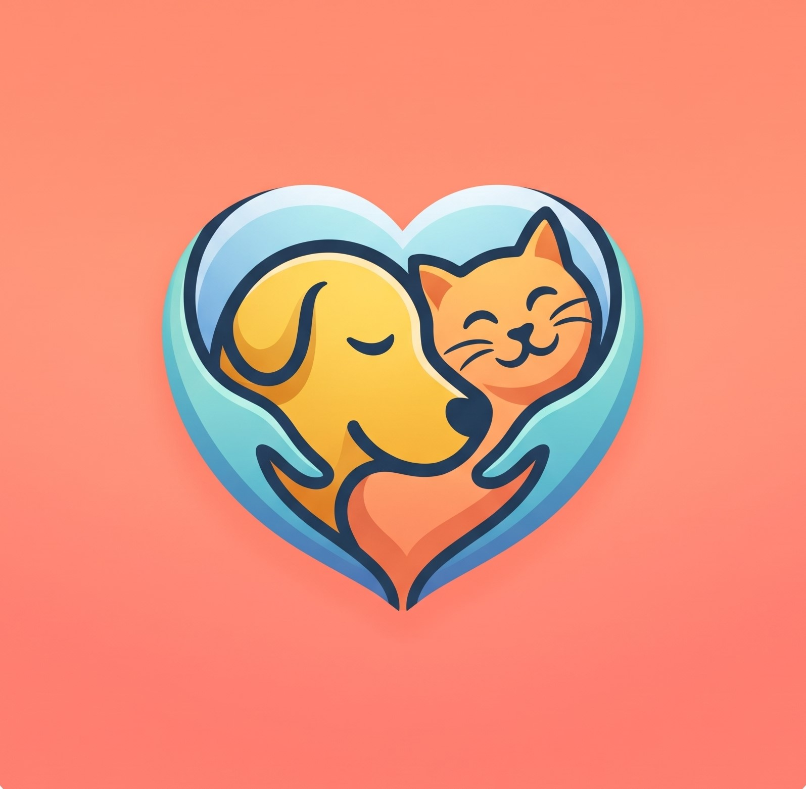
   
  🐾 Amigo-Pet v2.5.8
</h1>
Super App Comunitário Pet em Ecossistema Fechado, Rede de Economia Circular Solidária e Plataforma Georreferenciada de Apoio à Causa Animal.

          

# 📖 Sobre o Projeto

O **Amigo Pet** é um ecossistema mobile nativo desenvolvido para Android que integra, em um único ambiente digital, uma rede social comunitária de suporte mútuo entre tutores, uma central de economia circular 100% gratuita para doação de medicamentos e insumos, um portal de adoção responsável, um mural de eventos regionalizados e um mapa georreferenciado de serviços pet. O aplicativo foi [totalmente refatorado e melhorado desde a versão inicial](https://github.com/CFSC3/Amigo-Pet.git), evoluindo de um projeto básico para uma solução robusta e escalável em produção.

## ⚡ O Domínio do Problema

O sistema foi concebido para resolver gargalos críticos no ecossistema pet:
* **Alto Custo de Medicamentos e Abandono:** Tratamentos veterinários caros levam ao desespero e, em casos extremos, ao abandono de animais doentes.  
* **Desperdício de Insumos Sobressalentes:** Remédios e acessórios em perfeito estado terminam no lixo após a cura ou falecimento de um pet, enquanto outros tutores necessitam urgente de doações.  
* **Desorientação no Manejo Diário:** Tutores iniciantes enfrentam dificuldades para tirar dúvidas e encontrar suporte ágil na sua comunidade local.  
* **Invisibilidade de ONGs e Serviços Locais:** Falta de visibilidade integrada para feiras de adoção, abrigos e pequenos estabelecimentos de bairro.

# 🏗️ Arquitetura e Princípios

A versão 2.0 passou por uma refatoração profunda, abandonando práticas engessadas em favor de uma base escalável e profissional:
* **SOLID e Clean Code:** Código altamente coeso, limpo e de fácil manutenção, respeitando a responsabilidade única de cada classe.  
* **Desacoplamento:** Separação clara entre Views, Adapters, Repositories e UseCases, isolando a regra de negócio da interface.  
* **Estabilidade e Ciclo de Vida:** Tratamento rigoroso de NullPointerExceptions, memory leaks e sincronismo com chamadas assíncronas do Firebase.  
* **Segurança Integrada:** Trava sistêmica (VisitanteHelper) protegendo rotas, cliques e interações contra acessos não autenticados.

# ✨ Funcionalidades Principais

* **Feed Social & Comunidade:** Publicação de mídias (fotos e vídeos via ExoPlayer) e trocas comunitárias ("Marcas de Carinho") para tirar dúvidas e compartilhar histórias.  
* **Textos Inteligentes (Linkify & Clipboard):** Links em postagens, comentários e eventos são automaticamente clicáveis, com opções de menu integradas (BottomSheetDialogs) para cópia de textos.  
* **Economia Circular, Adoções e Doações:** Central 100% gratuita para doação de remédios, acessórios e ração com filtro geolocalizado (Memória de Localização por GPS).  
* **Chat em Tempo Real:** Comunicação direta entre usuários para agilizar adoções, dúvidas ou contato com ONGs.  
* **Mapa de Parceiros:** Visualização regionalizada de ONGs, Pet Shops e Clínicas Veterinárias com performance otimizada de carregamento.  
* **Mídia Aprimorada:** Captura direta pela câmera em qualidade original, substituição do obsoleto `drawingCache` e suporte para expansão de imagens horizontais em tela cheia na cor preta.

## 🌎 Escalabilidade Nacional e Modelo B2B Freemium

* **Multi-Estados:** Projetado e validado em produção com usuários operando simultaneamente em Amazonas (AM), Pará (PA) e Minas Gerais (MG), garantindo isolamento regional de anúncios e eventos.  
* **Sustentabilidade (B2B Freemium):** Mantém a gratuidade total para tutores e ONGs através da inclusão e destaque georreferenciado pago para Pet Shops e Clínicas Veterinárias no Mapa Interativo.

# 🛠 Tecnologias Utilizadas

* **Linguagem:** Java, Kotlin  
* **IDE:** Android Studio  
* **Backend:** Firebase (Authentication, Realtime Database, Storage)  
* **Geolocalização:** Google Maps API, FusedLocationProviderClient  
* **Mídia:** Glide, ExoPlayer (Vídeos), Android Image Picker, Camera `TakePicture` (Alta resolução)  
* **Ferramentas Nativas:** Linkify, ClipboardManager, BottomSheetDialog, SearchView, SwipeRefreshLayout

# 📱 Layout & UX/UI

O Amigo Pet v2.0 foi desenhado com foco no conforto visual e interações suaves, oferecendo suporte nativo à transição para o Modo Escuro.

|  |  |  |  |  |
| :---: | :---: | :---: | :---: | :---: |
| 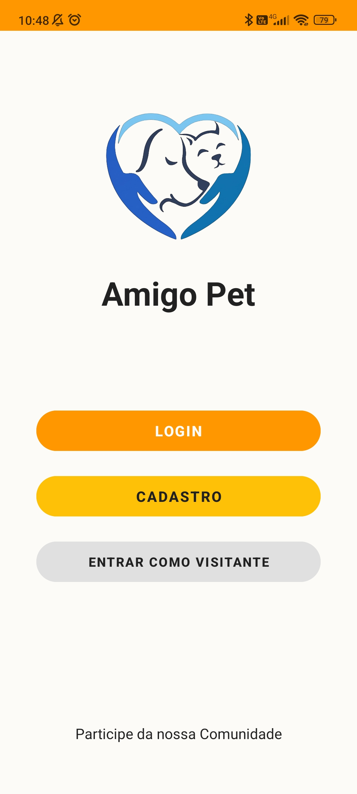 | 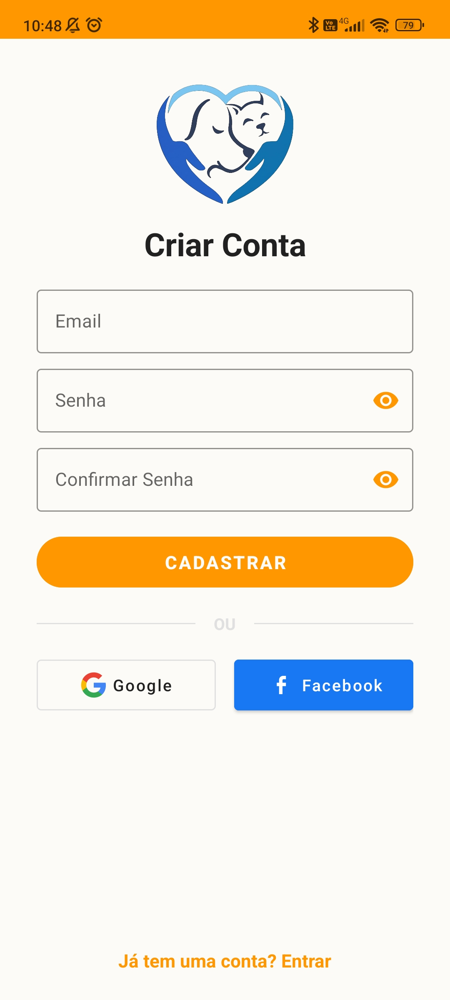 | 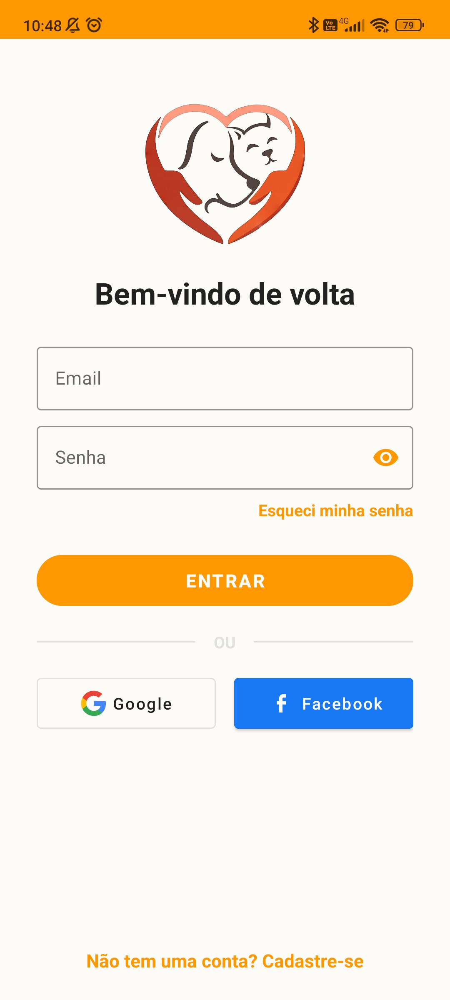 | 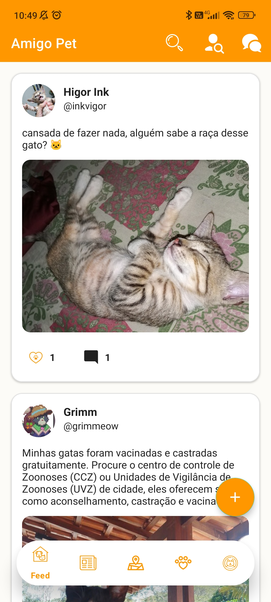 | 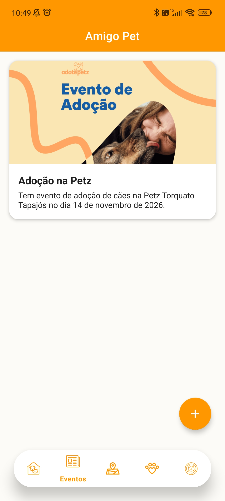 |
| 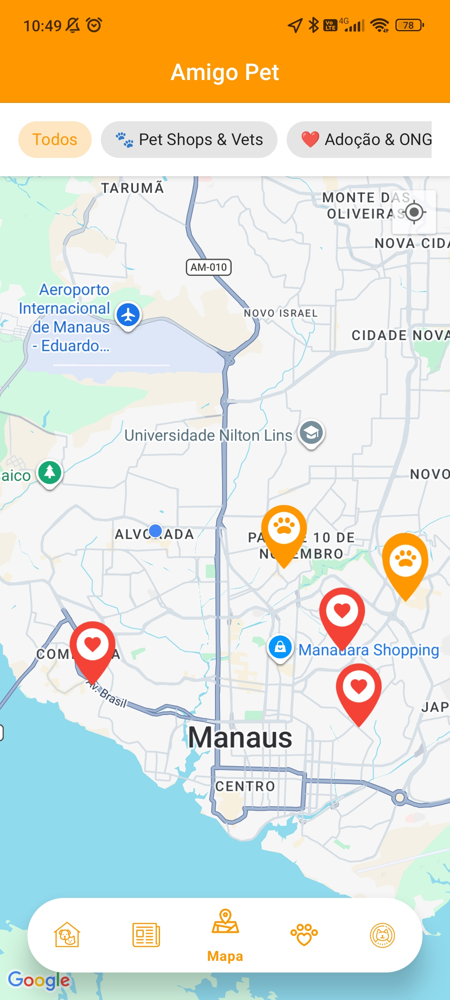 | 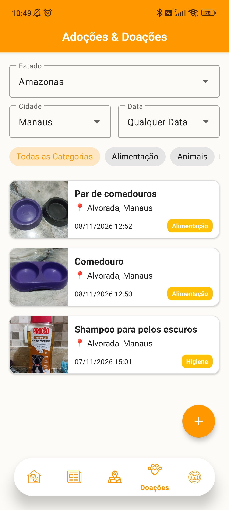 | 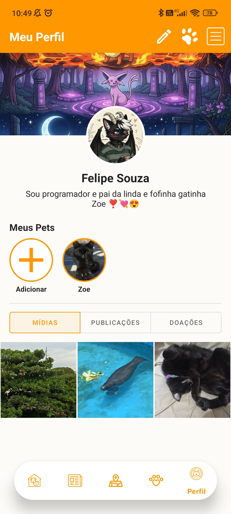 | 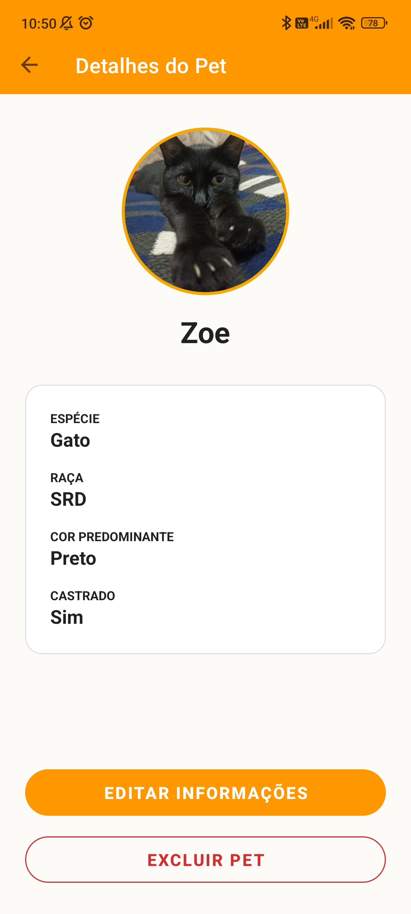 | 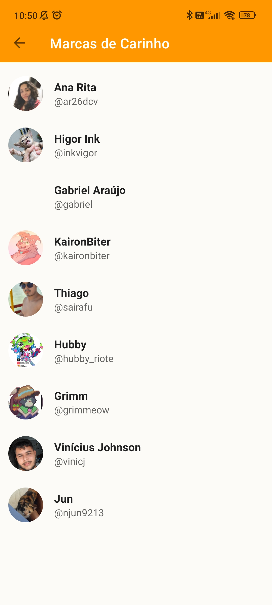 |
| 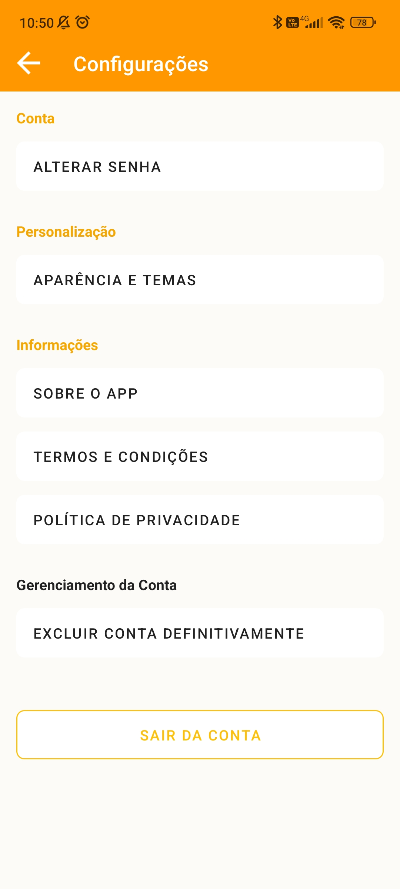 | 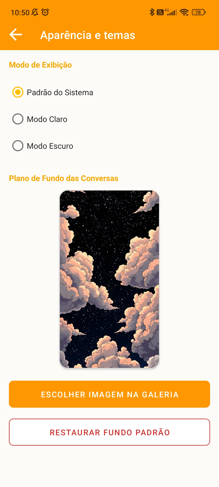 | 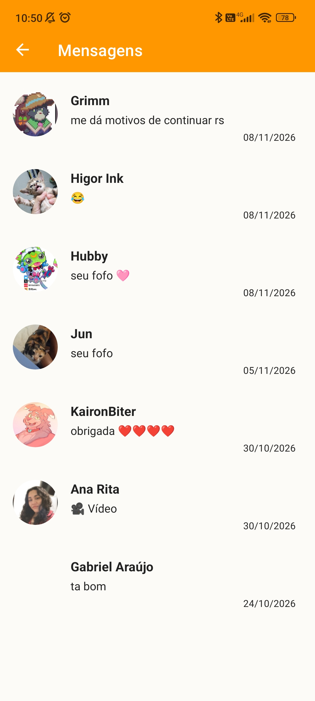 | 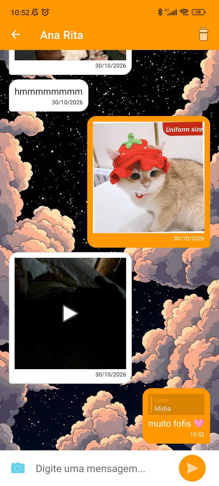 | 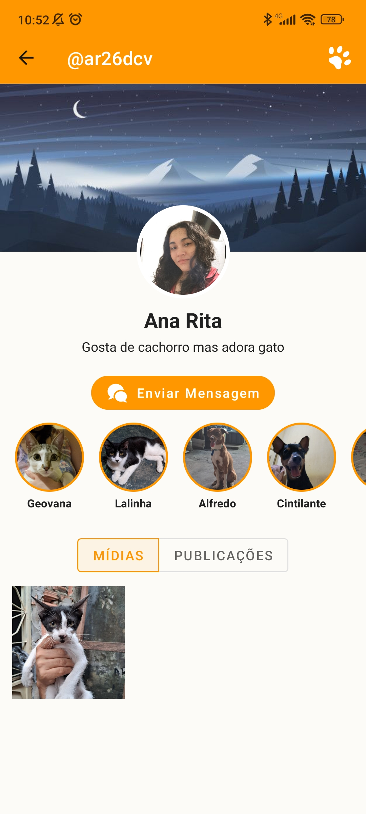 |

# 📲 Como Utilizar / Instalação

Para utilizar o aplicativo no seu dispositivo Android, não é necessário clonar o código-fonte. Baixe a versão mais recente do arquivo **.apk** diretamente na seção de **Releases** deste repositório e faça a instalação no seu smartphone.

# 👨‍💻 Autor

**Luz Nullings (Carlos Felipe Souza Carvalho)**

